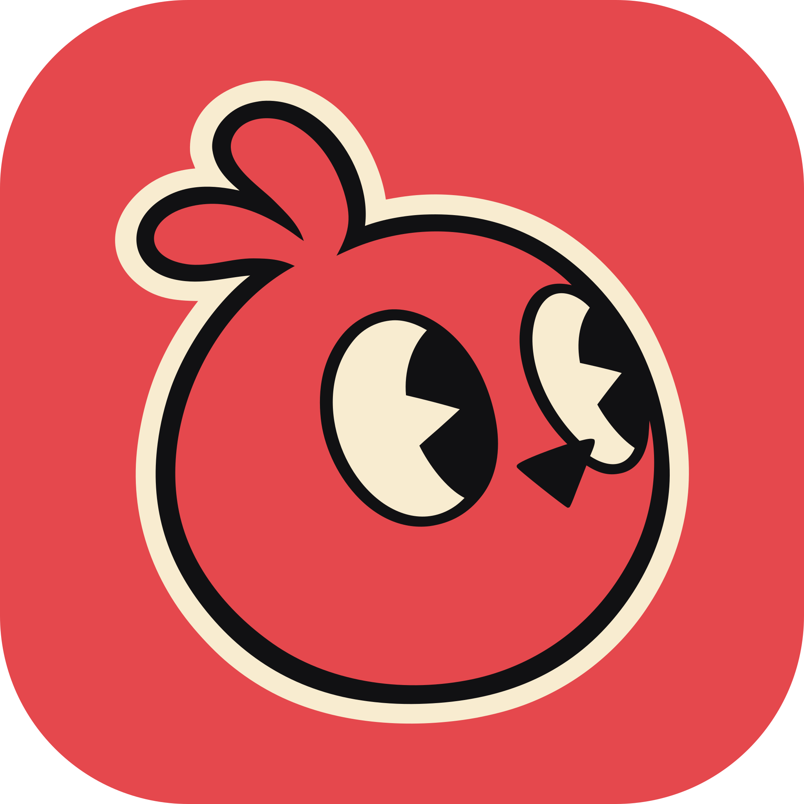
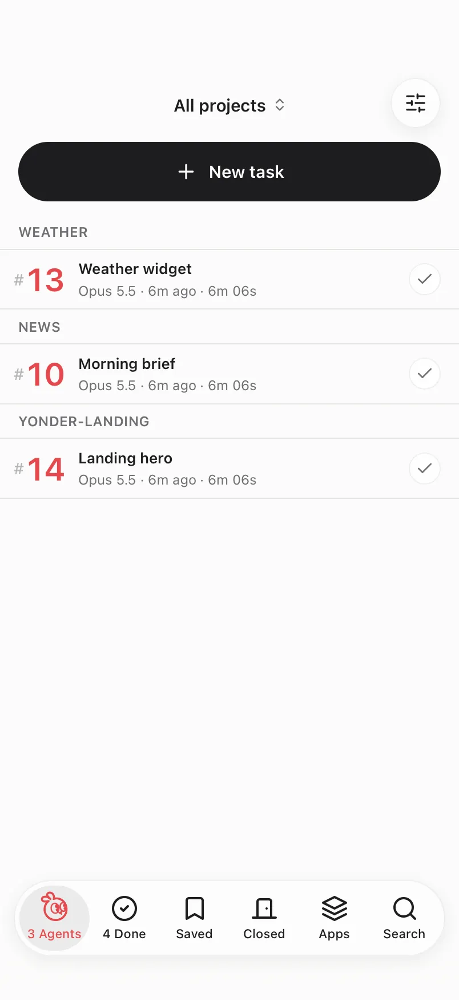
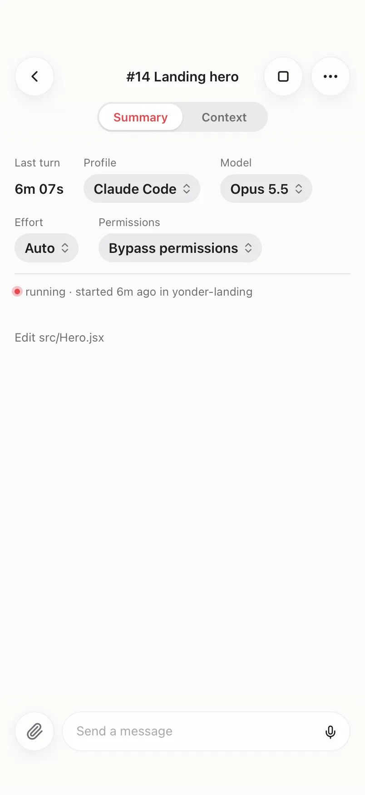
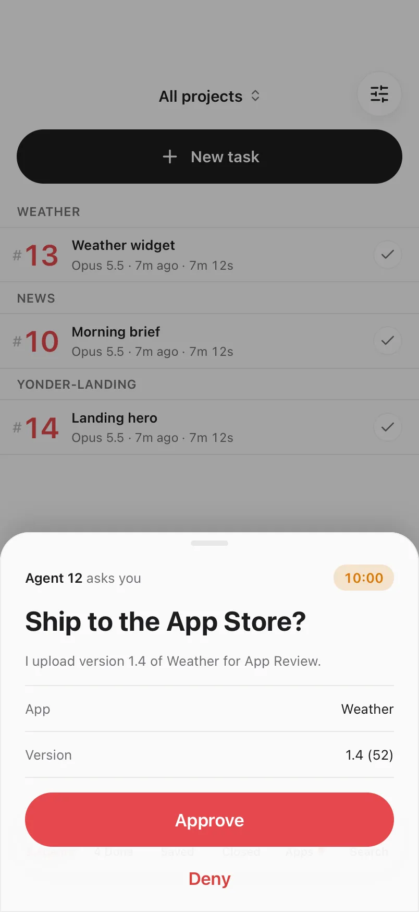
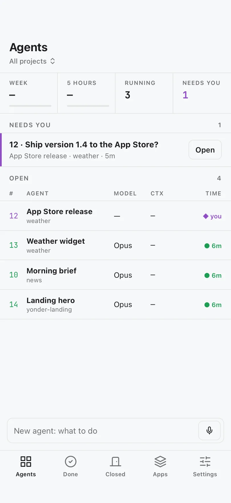
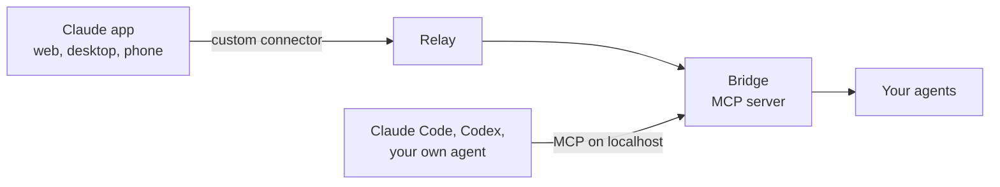
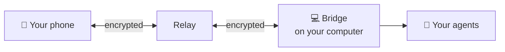
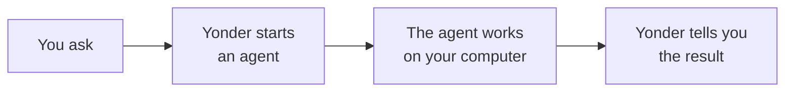

<p align="center">
  
</p>

<h1 align="center">Yonder</h1>

<p align="center">
  <strong>Chat, manage and voice call your local agents from any device.</strong><br>
  Leave your desk. Keep your computer.
</p>

<p align="center">
  <a href="LICENSE"></a>
  <a href="#get-yonder"></a>
  <a href="docs/guide.md#connect-another-agent"></a>
  <a href="https://apps.apple.com/app/yonder-voice-coding-remote/id6818920603"></a>
</p>

<p align="center">
  <a href="https://yonder.so">Website</a> ·
  <a href="#get-yonder">Download</a> ·
  <a href="docs/README.md">Docs</a> ·
  <a href="docs/guide.md">How it works</a> ·
  <a href="CONTRIBUTING.md">Contributing</a>
</p>

<p align="center">
  <picture>
    <source media="(prefers-color-scheme: dark)" srcset="themes/yonder/shots/agents-dark.webp">
    
  </picture>
</p>

## Why Yonder

Computers went from machines that filled a room, to desktops, to laptops
that we carry everywhere. We believe the next step is a world where we no
longer sit in front of them. We just talk to our computers, and almost
nothing stands between what we want and what they do.

Yonder is how we live that way now. We built it so that you can too.

**Reach your computer from anywhere.**
Your computer stays at home. You reach it from a walk, a coffee shop or a
hotel on the other side of the world, with no special network.

**The best interface is no interface.**
You talk to your agents in your own words, and they get to work. For most
of us, the interface that we do not notice is our own voice.

**Think out loud.**
The best ideas come on a walk or in the car, half formed and out of order.
Say them as they come, and your agents turn them into work.

**Generative interfaces. Software that fits you.**
Tell an agent how Yonder must look, and the whole app changes. When you
need a new tool, your agents build it as an app inside Yonder.

**Local first. Your computer stays yours.**
Your agents run on your own computer, with your files, your tools and your
logins. It is your machine, so you decide what leaves it.

**Yonder is the link.**
Yonder carries each message between your phone and your computer. Each one
is encrypted end to end, so only your own devices can read it. Not even we
can read it.

<sub>Read the full essay at <a href="https://yonder.so/vision/">yonder.so/vision</a>.</sub>

## What Yonder does

<table>
  <tr>
    <td align="center"><br><sub>A chat with one agent</sub></td>
    <td align="center"><br><sub>An approval, from your pocket</sub></td>
    <td align="center"><br><sub>The same agents, in another theme</sub></td>
  </tr>
</table>

### Your agents, in your pocket

Start an agent with a sentence, from the phone, the Mac or a voice call.
Each agent is a real session of its CLI on your computer. Follow it live,
answer its questions, approve its actions, send it files, and continue it
later in a terminal.

Yonder works with the agents that you already use: **Claude Code, Codex,
OpenCode, Cursor, Hermes, Copilot, Antigravity and Grok Build**, on your
own plans and logins.

### Workspaces and profiles

- A **workspace** groups your agents, such as "shop" or "Music". It has one
  home folder or none. A Claude Code agent starts in the home folder, and a
  Hermes agent can work across your folders.
- A **profile** chooses the agent harness of a task: Claude Code, Hermes,
  Codex or another CLI, with its own login. Keep a work account and a
  personal account apart, or give one workspace its own subscription.

### One phone, all your computers

Pair a Mac, a Linux server and a Windows PC. Each one is an
**environment** with its own bridge. The phone stays connected to each
one, shows their agents in one list, and starts a new agent on the
computer that you pick. Share one computer with other people, each with
their own phone, agents and answers.

### Agents that build for you

Agents make pages, small apps and web sites, and Yonder shows them on the
**Canvas** of your phone. **Preview** opens the dev server of an agent on
your phone through a private tunnel. **Schedules** start an agent at set
times, and **triggers** start one when something happens, such as a new
error in your error tracker.

### Make it yours

Change the look with a **theme**, or ask an agent to build a whole new
screen for you. Name your agents: numbers, first names, or your own word,
such as "tasks". Add skills, commands and tools to your agents with
**Claude Code plugins**. Export your whole setup to a file, and import it
on a new computer.

### Voice, if you want it

Voice is an optional module. Talk to your agents in a call: a voice agent
hears the task, starts an agent, and tells you the result in a few short
sentences. Use Grok with your own key, local speech, or your own voice
system. Read [Voice](docs/voice/README.md).

## Use Yonder from Claude, or any MCP client

The core of Yonder is one MCP server, the **bridge**. Each tool of Yonder
is an MCP tool: start an agent, list the agents, read a result, send a
message, move an agent to another computer. So any MCP client can drive
your agents, also the Claude app on your phone.



**Connect the Claude app**

1. In Yonder, open **Settings › Environments › MCP**, and tap **Copy**. Or
   tell an agent: "connect Claude".
2. In Claude, open **Customize › Connectors › Add › Add custom connector**.
3. Paste the address, and type the code that Yonder shows.

Now ask Claude, also in its voice mode: "What are my agents doing?" or
"Start an agent in the shop workspace that fixes the checkout button."

**Connect a local agent**

```sh
claude mcp add --scope user --transport http yonder http://127.0.0.1:7787/mcp
```

Each agent that Yonder starts already has the Yonder tools. The list of
tools is in [How Yonder works](docs/guide.md#connect-another-agent).

## How it works


Yonder puts a small server, the **bridge**, on your computer. The bridge
starts the agents and follows their work. Your phone reaches the bridge
through a relay that sees only encrypted bytes.



When you ask for something, this is what happens:



Your files, your agents and your logins stay on your computer. The full
story, with every part and every diagram, is in
[How Yonder works](docs/guide.md).

## Get Yonder

Install Yonder on a computer, then pair your phone with it.

| Platform | Get it | Setup |
|---|---|---|
| **macOS** 26 and later | [Download the app](https://download.yonder.so/Yonder.dmg) | [macOS setup](docs/setup/macos.md) |
| **Windows** 10 and 11 | `irm https://download.yonder.so/install.ps1 \| iex` | [Windows setup](docs/setup/windows.md) |
| **Linux** desktop or server | `curl -fsSL https://download.yonder.so/install.sh \| bash` | [Linux setup](docs/setup/linux.md) |
| **iPhone** | [App Store](https://apps.apple.com/app/yonder-voice-coding-remote/id6818920603) | [iPhone setup](docs/setup/iphone.md) |
| **Android** | [Download the APK](https://download.yonder.so/Yonder.apk) | [Android setup](docs/setup/android.md) |

Yonder is free and open source. The agents use your own CLI plans and
logins. Voice is optional: [set it up](docs/voice/README.md) with the
provider that you choose, or with your own system.

## Documentation

- [User manual](docs/manual/README.md): how to use each part of the app.
- [Docs index](docs/README.md): every doc in one list.
- [How Yonder works](docs/guide.md): the architecture, the concepts and
  all the diagrams.
- [Voice](docs/voice/README.md): the optional voice module, with Grok,
  local speech or your own system.
- [Run your own relay](https://github.com/vladartym/yonder-relay): keep your messages off our server.
- [Themes](themes/README.md) and [plugins](docs/guide.md#plugins-and-mods): make Yonder
  yours.

## Contributing

We welcome bug reports, ideas and pull requests. Read
[CONTRIBUTING.md](CONTRIBUTING.md) to set up the source and run the checks.
To report a security problem, read [SECURITY.md](SECURITY.md).

## License

The code is under the [MIT license](LICENSE). The name Yonder, the bird and
the icons are not. Read [TRADEMARK.md](TRADEMARK.md).
