# Yonder: the full guide

This guide tells how Yonder works, part by part, with all the setup steps
and diagrams. For the short version, read the [README](../README.md).

To use Yonder, read the docs at <https://yonder.so/docs/>. This guide is
for the people who read, build or change the source.

## Contents

1. [The big picture](#the-big-picture)
2. [Words that Yonder uses](#words-that-yonder-uses)
3. [The life of a task](#the-life-of-a-task)
4. [Agents and their statuses](#agents-and-their-statuses)
5. [CLIs: how each agent runs](#clis-how-each-agent-runs)
6. [Workspaces](#workspaces)
7. [Profiles](#profiles)
8. [Environments](#environments)
9. [The phone, the relay and the encryption](#the-phone-the-relay-and-the-encryption)
10. [Voice calls](#voice-calls)
11. [Themes and screens](#themes-and-screens)
12. [Plugins and mods](#plugins-and-mods)
13. [Schedules and triggers](#schedules-and-triggers)
14. [Canvas and Preview](#canvas-and-preview)
15. [Where the data lives](#where-the-data-lives)
16. [Install](#install)
17. [Connect another agent](#connect-another-agent)
18. [Develop](#develop)
19. [Versions and releases](#versions-and-releases)
20. [Security](#security)
21. [Cost](#cost)
22. [A map of the repository](#a-map-of-the-repository)
23. [Planned](#planned)
24. [License](#license)

## The big picture

Yonder has three layers: the **clients** that you use, the **bridge** on
your computer, and the **agents** that the bridge starts. The bridge is the
only part that starts or stops an agent.

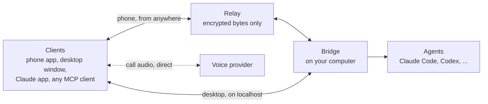

Three facts explain most of the design:

1. **The bridge opens no port to the internet.** It listens only on
   `127.0.0.1`. It reaches the phone through an outbound WebSocket to the
   relay, so your computer needs no open port and no VPN.
2. **The voice goes direct.** The phone sends the audio of a call straight
   to the voice provider. Only the tool calls go through your computer, so
   the path to your computer does not slow down the voice.
3. **An agent is a normal CLI session.** A Claude Code agent is a real
   `claude --bg` session. It shows in `claude agents`, and you can attach
   to it in a terminal.

## Words that Yonder uses

Yonder uses each of these words for one meaning only.

| Word | Meaning |
|---|---|
| **Bridge** | The MCP server on your computer (`bridge/main.ts`). It starts, follows and stops the agents, and serves the screen. |
| **Agent** | One coding session that does one task in one workspace. The code also calls it a *worker*. |
| **CLI** | The program that runs an agent: Claude Code, Codex, OpenCode, Cursor, Hermes, Copilot, Antigravity or Grok Build. |
| **Workspace** | A named group of agents, with one home folder or none. It replaces the older word *project*. |
| **Profile** | Which agent harness runs a task, such as Claude Code or Hermes, with its own name, login, flags and variables. "Work" and "Personal" are typical profiles. |
| **Environment** | A computer that runs a bridge and that you paired with the phone, also called a *host*. Yonder never uses this word for environment variables. |
| **Person** | Someone who uses the computer with their own phone. Each agent has one person as its owner. |
| **Relay** | A small WebSocket server that connects the phone to the bridge. It forwards encrypted bytes only. |
| **Voice agent** | The realtime voice model of a call. It hears you, calls the tools of the bridge, and talks back. |
| **Screen** | The user interface (`src/`). One React app runs on each device. |
| **Theme** | A look for the screen: a *style* (one JSON file) or an *own screen* (a full page). |
| **Mod** | A Claude Code plugin that draws in the terminal. Yonder shows what the mods of an agent draw. |
| **Schedule** | An agent that starts at set times. |
| **Trigger** | An agent that starts when something happens, from a webhook or a script. |
| **Canvas** | The tab for what the agents make: pages, apps, web sites and approvals. |

## The life of a task

You say "In the shop workspace, fix the checkout button." This is what
happens:

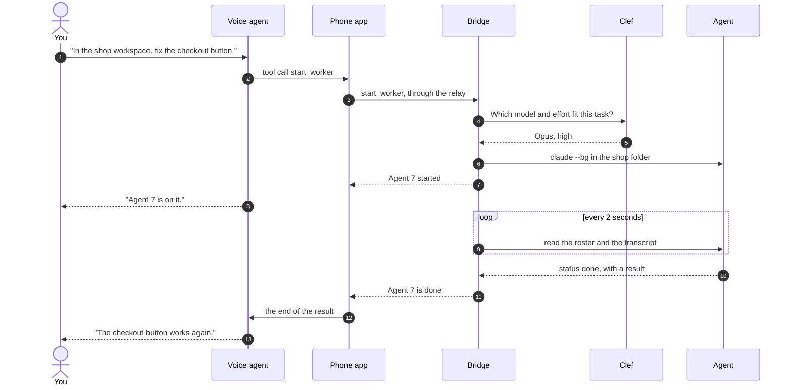

- **The bridge starts the agent at once.** The new agent shows in the list
  as "Starting" within a second. It gets its session ID about one second
  later.
- **Clef picks the model and the effort** when the request names none.
  Clef is a small fast model on Cloudflare Workers AI. A question gets a
  small model and low effort. A large rewrite gets the strongest model and
  max effort. Each pick then moves into the range that you set in the
  Settings. Without Clef, the bridge uses a strong model with high effort.
  Clef runs on your own Cloudflare account: put `CLOUDFLARE_ACCOUNT_ID` and
  `CLOUDFLARE_AI_TOKEN` (a Workers AI token) in `~/.config/yonder/.env`.
  Yonder ships no key, so with none Clef is simply off.
- **The bridge polls.** Every 2 seconds it reads `claude agents --json
  --all` and the transcript of each agent. So it knows what each agent does
  now, and when it is done.
- **The voice agent reports.** When an agent is done, the app gives the end
  of the result to the voice agent, and the voice agent tells you.

You can do the same with no voice. Type the task in the chat, or start an
agent from the desktop window. On a Mac, tap the right ⌘ key to open the
notch, say the task, and tap it again to send.

## Agents and their statuses

An agent has one of five statuses. The CLI gives the status. Yonder only
closes and removes agents.

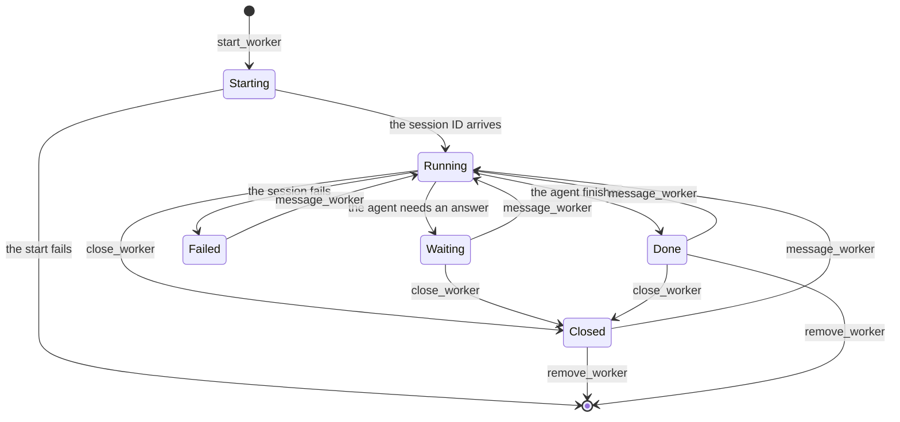

| Status | Meaning | Tab |
|---|---|---|
| `running` | The agent works now. | Agents |
| `waiting` | The agent needs an answer from you. Claude Code calls this `blocked`. | Agents |
| `done` | The agent finished its turn. | Done |
| `failed` | The session failed. | Done |
| `closed` | You closed the agent. A message continues it. | Closed |

Some rules that are not obvious:

- **A message to a running agent waits in a queue** until the agent
  finishes its turn. `unqueue` takes it back.
- **A new model, effort or profile starts a copy of the session.** A
  background session keeps the options of its start, so the bridge stops
  it and resumes it with the new options. The conversation stays the same.
- **Your other Claude Code sessions show too.** The bridge lists the
  sessions that you started in a terminal, as "terminal" or "background".
  Yonder cannot type into a terminal. So a message to such a session starts
  a copy (`claude --bg --resume <id> --fork-session`), and the session in
  the terminal does not change.
- **`MAX_RUNNING` stops a loop.** Each agent can call the tools of Yonder,
  also `start_worker`. A limit on the agents that run at the same time
  stops an agent that starts agents without end.

## CLIs: how each agent runs

Each agent runs in one CLI and keeps it for all its turns. Yonder drives
each CLI in the way that keeps the agent alive when the bridge or the app
restarts.

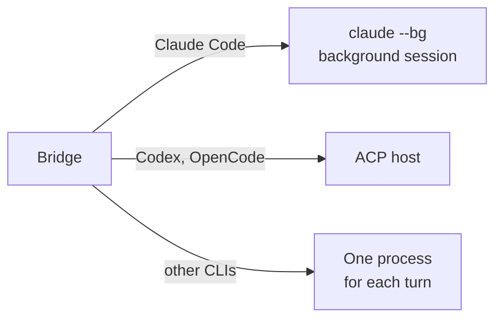

- **Claude Code** runs as `claude --bg`. The background service of Claude
  Code owns the session, so the agent keeps running when the bridge stops.
  Yonder does not use the Agent SDK or an ACP adapter for Claude Code,
  because the terms of the Agent SDK do not allow a third party to offer
  the claude.ai login.
- **Codex and OpenCode** run in the ACP host, a detached Bun process that
  speaks the [Agent Client Protocol](https://agentclientprotocol.com). It
  holds one ACP process for each agent. An agent with no turn for 30
  minutes stops, and its next turn resumes the session.
- **The other CLIs** run one detached process for each turn, in their own
  process group. The output goes to a file, so a turn keeps running when
  the bridge restarts, and the next bridge finds it by its process ID.

Settings › Profiles lists each CLI with its version, its sign-in and an
Install or Update button. The bridge finds each CLI on the `PATH` and in
the folders of the installers (`bridge/clis.ts`). Yonder never reads or
copies the token of a CLI. Each sign-in is the sign-in of the CLI itself.

## Workspaces

A **workspace** is a named group of agents, such as "Music" or "shop". It
has one home folder or none. It is the only group of agents in Yonder.

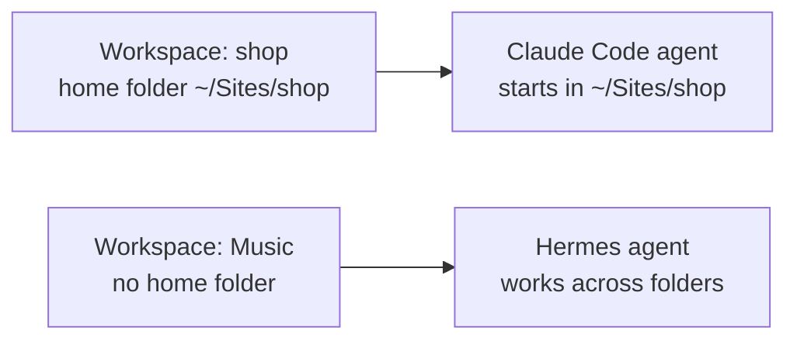

- **A Claude Code agent starts in the home folder** of its workspace. A
  workspace with no folder, such as one for a Hermes agent that works
  across the computer, starts its agents in the default folder
  (`~/Yonder`).
- **Each workspace has its own id**, not a path. Each agent records the id
  of its workspace, and the screen groups the agents by it.
- **One folder is the home of one workspace only.**
- **When the request names no workspace**, Yonder picks it from the task,
  with the names and the descriptions of the workspaces.
- **A workspace can have its own default profile.** See the next section.

### The config file

The workspaces are the key `workspaces` of `~/.config/yonder/config.json`.
An agent can add, change and remove a workspace by an edit of this file,
with no click. The bridge reads the file again when it changes.

```json
{
  "workspaces": [
    { "id": "shop", "name": "shop", "folder": "~/Sites/shop", "starred": true, "profile": "work" },
    { "id": "music", "name": "Music", "description": "Songs and mixes with the Hermes agent." }
  ]
}
```

| Field | Rule |
|---|---|
| `id` | Required. Lowercase letters, digits, `-` and `_`. It never changes. |
| `name` | Required. The name on the screen and in the voice. |
| `folder` | The home folder. At most one. |
| `description` | What the workspace is for. Required when there is no folder. |
| `starred` | `true` puts the workspace at the top. |
| `profile` | The default profile of each new agent in the workspace. |

The bridge checks each entry on its own. It leaves out a bad entry, keeps
the others, and gives the errors in `list_workspaces`. The full rules are
in `docs/wiki/workspaces.md`.

## Profiles

A **profile** is a CLI with its own name, its own login and its own
options. Use profiles to keep two accounts apart, such as a work plan and
a personal plan, or to give one workspace its own subscription.

### What a profile holds

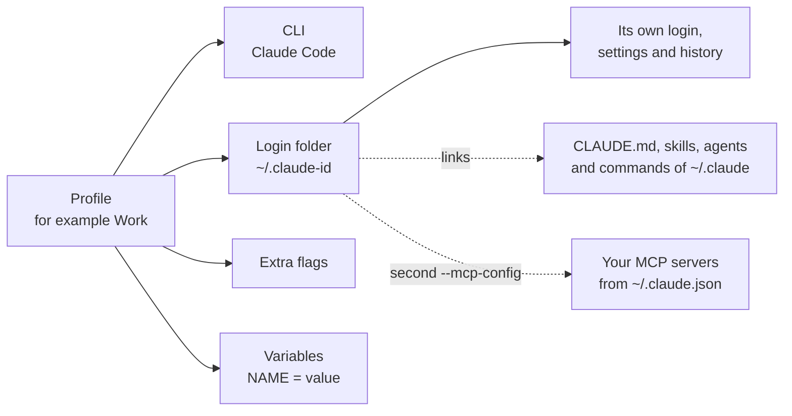

| Field | What it does |
|---|---|
| **Name** | The name that you say, such as "use my work profile". |
| **CLI** | The program of the profile. One profile has one CLI and one login. |
| **Separate account** | Claude Code only. It gives the profile its own config folder, `~/.claude-<id>` (`CLAUDE_CONFIG_DIR`). Its agents then have their own login, settings and history. |
| **Default MCP servers** | With a separate account, each new session also gets your MCP servers from `~/.claude.json`. On by default. |
| **Program** | Another binary for the CLI. Under Advanced. |
| **Extra flags** | Flags that come before the flags of Yonder. A flag of Yonder that comes again, such as `--model`, wins. The page refuses the flags that Yonder sets itself, such as `--resume`. |
| **Variables** | Environment variables for the agents of the profile. The value shows as a password. |

A new login folder gets links to `CLAUDE.md`, `skills`, `agents` and
`commands` of `~/.claude`, and a copy of `settings.json`. So your rules
and skills stay the same in each profile.

> [!NOTE]
> Each profile is a sign-in of the unmodified `claude` in its own folder.
> Yonder does not proxy, store or share the OAuth tokens of Claude Code.

### Which profile a new agent gets

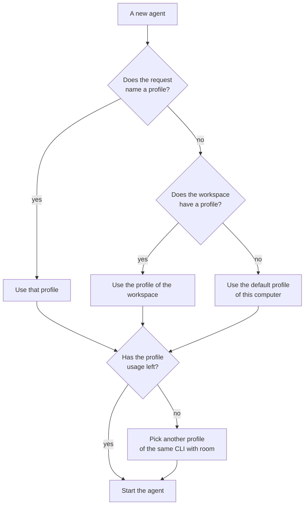

- **The default profile** is in Settings › General. Each computer has its
  own default.
- **The profile of a workspace** is the `profile` field of the workspace,
  or the tool `set_workspace_profile`. It changes only
  the new agents. The agents that run keep their profile.
- **A move to another profile** keeps the conversation. Use the Profile
  menu of an open agent, or `message_worker` with `profile`. Claude Code
  copies the session into the folder of the new profile and resumes it
  there. The new profile must run the same CLI.
- **A schedule** with no profile of its own starts on the profile of its
  workspace.

### How the variables reach the agent

A session of `claude --bg` gets its environment from the background
service of Claude Code, not from the command that starts it. So the bridge
puts the variables of a profile in the `env` of `--settings`. For the other
CLIs, the variables go in the environment of each turn.

Each login folder also has its own background service. So the bridge runs
`claude agents` once for each folder, and it runs `claude stop`, `rm` and
`attach` with the environment of the profile of the agent.

### What follows you to other computers

When you sign in to a Yonder account, the profiles follow you to each
computer:

| Goes to each computer | Stays on one computer |
|---|---|
| The name, the CLI, Separate account, the extra flags | The variables, the login folder, the program, the default profile, the profiles of the workspaces |

On a new computer, a profile with a separate account asks you to sign in
once.

## Environments

An **environment** is a computer that runs a bridge: a Mac, a Linux
desktop, a Linux server or a Windows PC. One phone can pair with many
computers, and it stays connected to each of them.

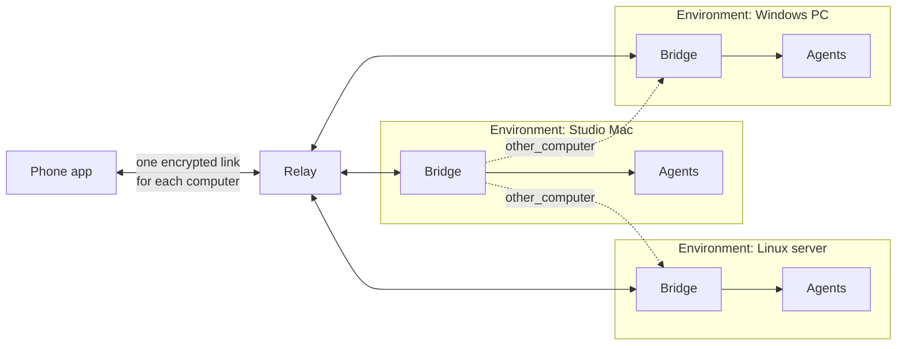

- **The computer in use** is the computer of the last workspace that you
  opened. The chat, the files, the paper clip and Preview work on it.
- **The other computers still show.** The phone opens a second encrypted
  link to each other computer, and loads its workspaces and agents every 15
  seconds. A computer that gives no answer in 8 seconds shows as
  Disconnected.
- **The environment button** in the title bar picks All environments, the
  computer in use, or one other computer. On the desktop, ⌘E moves to the
  next one. A pick of another computer acts as if you work on it: a new
  agent starts there, and the usage meter shows its usage.
- **The voice agent stays on one computer.** To act on another computer,
  it calls `other_computer` with the name of a tool and its arguments.
  The bridge there checks the call with its own rules, as for a local
  call.
- **Each computer has its own settings.** Its name (`computerName`), its
  default profile and its workspaces stay on that computer.
- **Hide a computer** with its switch in Settings › Environments. It stays
  paired, and the voice agent still reaches it when you name it.

### More than one person on one computer

Two people or more can use one environment, each with their own phone.
All of them share one OS account, the same files and the same agents.

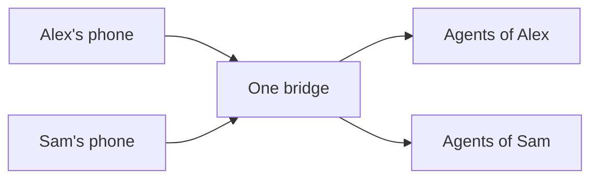

- Each agent has an **owner**. Its questions, approvals and notifications
  go to the phones of that person.
- `list_workers` gives the agents of the person who asks, and `scope: "all"`
  gives everyone. The app shows a **Mine / Everyone** switch only with two
  people or more.
- The people are the key `people` of `config.json`, with their phones and
  their default profile and workspace. An agent edits the file, and the
  bridge applies it at once.

Read [People on one computer](manual/people.md).

The phone introduces the paired computers to each other. So a Mac also
shows the workspaces and the agents of the other computers.

## The phone, the relay and the encryption

The phone talks to the bridge through the relay. The relay sees only
encrypted frames, so it cannot read or change a message.

### Pairing

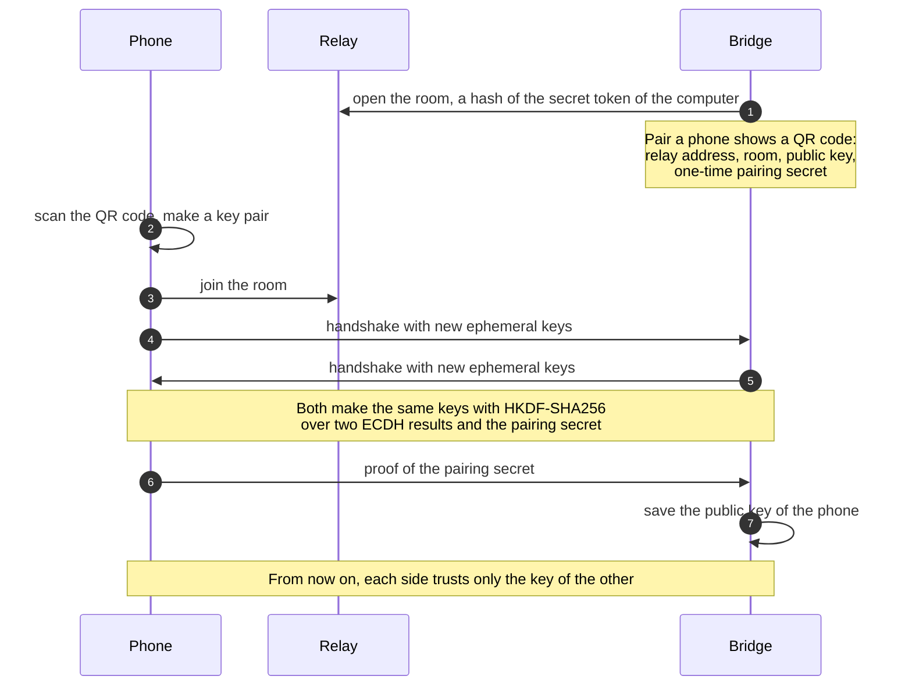

- The QR code works one time, for 5 minutes. A photo of an old code is of
  no use.
- The room comes from a secret token that only the computer knows. So the
  phone cannot take the place of the computer on the relay.
- Remove a phone in Pair a phone, and the bridge refuses its key.
- On a Linux server, `yonder pair` shows the QR code in the terminal.

### Each connection

- Each device has a long-term ECDH key pair on the P-256 curve. The private
  key of the computer is in `~/.config/yonder/relay.json` (mode 600). The
  private key of the phone is a non-extractable WebCrypto key.
- Each connection starts with new ephemeral keys. The keys of the
  connection come from HKDF-SHA256 over the ECDH of the long-term keys and
  the ECDH of the ephemeral keys.
- Each frame is AES-256-GCM, with one key for each direction. The nonce is
  a counter, and the receiver accepts only the next counter. So the relay
  cannot replay a frame, such as a `start_worker` request.
- The phone sends normal HTTP requests inside the frames, such as
  `POST /mcp`. The bridge runs them on its own endpoints. It accepts only
  the paths that the app needs.

> [!WARNING]
> The relay must never serve the page of the phone app. A hacked relay
> could then send a page that steals the keys. So the phone app is a real
> app that holds its own code.

The **Claude app connector** is the one exception. Claude's servers cannot
encrypt end to end, so the relay ends HTTPS for the requests of a
connector (`https://mcp.yonder.so/<id>`) and passes each one to your
computer. The relay can read these requests. It does not log or keep them,
and your computer checks the token of each request.

### Run your own relay

Yonder uses the relay at `wss://relay.yonder.so` by default. The relay is
one file, [`relay/main.ts`](../relay/main.ts), and it needs only Bun. Run your
own, and your messages do not go through our server.

1. Get a server with Docker, a domain name that points to it, and the
   ports 80 and 443 open.
2. Clone this repository on the server, and go to its `relay` folder.
3. Make a `.env` file next to `relay/compose.yml` with `DOMAIN=relay.example.com`.
4. Start the relay: `docker compose up -d --build`. Caddy gets the HTTPS
   certificate.
5. In Yonder on your computer, open Settings › Pair a phone › Relay.
6. Type `wss://relay.example.com`, and click Save. This writes
   `YONDER_RELAY` in `~/.config/yonder/.env`.
7. Pair your phone again. The new QR code holds the address of the relay.

The [relay README](../relay/README.md) tells what the relay sees, and how to
allow only your own computers with `ROOMS`.

## Voice calls

Voice is an optional module. Without it, you chat with your agents. With
it, a voice agent hears you, calls the tools of the bridge as function
tools, and talks back. The module is pluggable: Grok with your own key,
other cloud models, local speech, or your own voice system.

- **The state of the agents is in the prompt.** The voice agent knows what
  each agent does without a tool call, so it can answer at once.
- **The audio goes direct.** With a cloud provider, the phone sends the
  audio straight to the provider. Only the tool calls go through your
  computer, and the API key stays on your computer.
- **Calls are on the phone.** The desktop has the chat, the dictation and
  the notch.

The [voice docs](voice/README.md) tell how each option works, and how to
set it up.

## Themes and screens

The screen is one React app (`src/`). A theme changes how it looks. A
theme is one of two kinds:

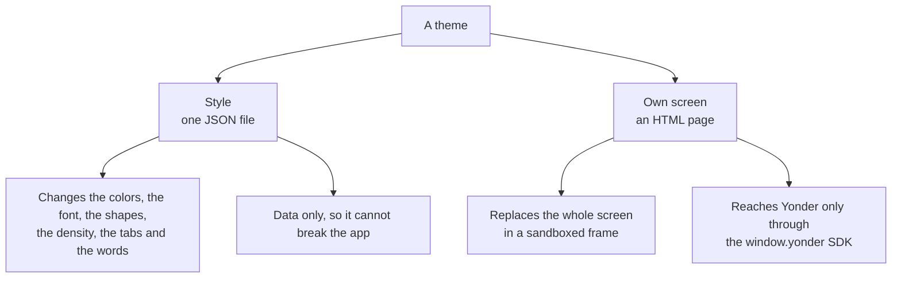

- **The built-in themes** are in [`themes/`](../themes/), one folder
  each: `theme.json` for the style, `page.html` for an own screen, and
  the pictures in `shots/`.
- **Your own themes** are in `~/.config/yonder/themes/<name>/`, with one file
  for each version. Ask an agent to "make me a screen that…", and it
  builds the theme on your computer. The phone gets each new version in
  seconds.
- **The SDK** of an own screen is in [`docs/screen-api.md`](screen-api.md).
  The design is in [`docs/ui-themes.md`](ui-themes.md).
- **To share a theme**, add it to `themes/` in a pull request.
  [`themes/README.md`](../themes/README.md) tells how.

## Plugins and mods

A Yonder plugin is a Claude Code plugin. Yonder adds no new format. A
plugin can give the agents skills, commands, hooks, MCP servers and
subagents.

- **Yonder's own mod** is in [`plugins/yonder/`](../plugins/yonder/). The
  bridge writes it to `~/.config/yonder/mod/` at each start
  (`bridge/mod.ts`), and each Claude Code agent loads it with
  `--plugin-dir`.
- **Your plugins** are in `~/.config/yonder/plugins/<name>/`. Each
  Claude Code agent loads each plugin of that folder with one more
  `--plugin-dir`.
- **What a mod draws.** A mod can draw in the terminal: a band above the
  prompt, a pane, a status line or a toast. An agent of Yonder runs in a
  terminal that nobody sees. So Yonder's mod reads what the other mods
  draw, posts it to the bridge (`POST /mods`), and the screen shows it in
  the chat of the agent (`src/Mods.tsx`).
- **The limits.** Only the Claude Code agents load plugins. The voice agent
  does not get the tools of a plugin; it uses them through an agent. A
  plugin runs with all the rights of your user, so install only a plugin
  that you trust.

To make a plugin, read [`plugins/README.md`](../plugins/README.md).

## Schedules and triggers

The bridge runs all the time on your computer, so it holds the timers. The
agents of a schedule or a trigger run on your computer, with its CLIs and
its logins.

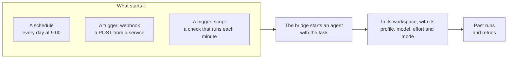

- A **schedule** has a name, a workspace, a task and a timing. It can also
  have a profile, a CLI, a model, an effort and a mode, and you can pause
  it.
- A **trigger** is a schedule with an event in place of a timing. It starts
  from a webhook or from a script. The bridge runs the script each minute
  in the folder of the workspace, and each new line that the script prints
  is one event. A script can call any API or any CLI, so an error tracker,
  a form or a CI job can each start an agent. "Set up with Claude Code"
  starts an agent that writes the script for you.
- Yonder does not use the cloud routines of Claude Code for this. A cloud
  routine runs on a copy of a repository, with no CLI and no login of your
  computer.

## Canvas and Preview

- **Canvas** is the tab for what the agents make and ask: the pages and
  small apps that an agent makes (`show_app`, `build_app`), the web sites
  of each computer, and the approvals that wait for you. The design is in
  [`docs/canvas.md`](canvas.md).
- **Preview** opens the local web site of an agent, such as a dev server on
  `http://localhost:5173`, on your phone, through a private HTTPS tunnel. A
  tunnel opens only after you say yes. The design is in
  [`docs/tunnel.md`](tunnel.md).
- **An agent cannot open a site by itself.** It names the URL in its final
  message, and you open it from the chat.

## Where the data lives

All the data of Yonder stays on your computer, in `~/.config/yonder/`. A
second bridge for a test, with `YONDER_PORT=7799`, uses
`~/.config/yonder-7799/`.

| File or folder | What it holds |
|---|---|
| `.env` | The keys, such as `XAI_API_KEY`, and `YONDER_RELAY` for your own relay. |
| `config.json` | The settings of this computer: the model range, the permissions, the profiles, the workspaces, the people, the name of the computer, and the `port` and `token` of the bridge. |
| `phone.json` | The settings of the phone, such as the theme and the fonts. The phone syncs it. |
| `state.json` | The agents, the stars, the added folders and the schedules. |
| `relay.json` | The private key and the pairings of the relay link (mode 600). |
| `themes/<name>/` | Your own themes, one file for each version. `ui/` is a link to it, the old name. |
| `mod/` | Yonder's own mod, written again at each start. |
| `plugins/<name>/` | Your plugins, one folder for each. Each Claude Code agent loads them. |
| `runs/` | The output of each turn of a CLI that runs one process for each turn. |
| `mcp-default.json` | Your MCP servers, for the profiles with a separate account. Only you can read it. |
| `bridge.log`, `call.log`, `app.log` | The logs of the bridge, the voice calls and the desktop app. |

You can edit `config.json` and `phone.json` by hand. The bridge reads the
change with no restart.

The bridge saves `state.json`, `config.json` and `phone.json` through a
copy and a rename, and keeps the file before each save as `<file>.bak`.
**Settings › General › Export** saves the setup to a file, with or
without keys, and **Import** merges it on another computer. An agent does
the same with the tools `export_config` and `import_config`. Read
[Back up and move](manual/backup.md).

[`docs/data.md`](data.md) lists what leaves your computer, and where
it goes.

## Install

Each platform has its own setup doc: [macOS](setup/macos.md),
[Windows](setup/windows.md), [Linux](setup/linux.md),
[iPhone](setup/iphone.md) and [Android](setup/android.md).

A fork must use its own bundle ID and Apple team ID. The bundle ID
`com.vladartym.yonder` and the team ID belong to the official apps in the
stores. Change the bundle ID in the Tauri configs, and set
`APNS_TEAM_ID`. The name Yonder, the bird and the icons are not under the
MIT license. Read [`TRADEMARK.md`](../TRADEMARK.md).

## Connect another agent

The bridge is an MCP server (Streamable HTTP) at
`http://127.0.0.1:7787/mcp`. Each Yonder agent gets it with `--mcp-config`
when it starts, so the agents can call Yonder with no setup.

The port is `port` of `~/.config/yonder/config.json`, 7787 by default.
When another OS user of the computer has port 7787, the bridge takes the
next free port and saves it there. A program of your own OS user needs no
key. Any other caller needs the `token` of `config.json` in the header
`x-yonder-token`.

To give it to each Claude Code session on your computer, also the sessions
in a terminal:

```sh
claude mcp add --scope user --transport http yonder http://127.0.0.1:7787/mcp
```

For another client:

```json
{ "mcpServers": { "yonder": { "type": "http", "url": "http://127.0.0.1:7787/mcp" } } }
```

The main tools, by group. `about_yonder` and the list of tools of the
bridge give the full set.

| Group | Tools |
|---|---|
| **Workspaces** | `list_workspaces`, `add_workspace`, `edit_workspace`, `remove_workspace`, `star_workspace`, `set_workspace_profile`, `workspace_overview`, `show_workspace` |
| **Agents** | `start_worker`, `message_worker`, `stop_worker`, `unqueue`, `list_workers`, `review_workers`, `get_worker`, `rename_worker`, `move_worker`, `star_worker`, `close_worker`, `remove_worker`, `open_in_terminal` |
| **Files and links** | `send_file`, `create_upload`, `read_file`, `open_folder`, `open_link`, `copy_to_clipboard` |
| **Canvas and Preview** | `show_app`, `build_app`, `change_app`, `remove_app`, `preview`, `browser` |
| **The phone and the user** | `ask_user`, `phone`, `get_location`, `remind`, `notify` |
| **Automation** | `schedule` |
| **Look and settings** | `set_theme`, `customize`, `cli`, `get_usage`, `export_config`, `import_config` |
| **Other computers** | `other_computer` |
| **Secrets** | `use_secret`, `list_secrets` (1Password, for the agents only; the user approves each use on the phone) |
| **Yonder itself** | `about_yonder`, `connect_claude`, `rebuild_app`, `restart_bridge` |

`rebuild_app` and `restart_bridge` show only on a copy that runs from the
source.

## Develop

| Command | What it does |
|---|---|
| `bun run bridge` | Runs the bridge with a reload on each change. Start it before the app, so the app uses it. |
| `bun tauri dev` | Runs the desktop app with a reload of the screen on each change. |
| `bun run check` | Checks the types. |
| `bun run check-bridge` | Starts a bridge on a free port with an empty home folder, and checks that it serves its tools. It starts no agents. |
| `bun run check-relay` | Checks the relay, the pairing and a fake phone from end to end. Set `RELAY_URL=wss://…` to check a relay that runs elsewhere. |
| `bun run check-upgrade` | Checks an upgrade from the last release. |
| `bun run check-preview` | Checks the HTTP server of Preview, with no network. |
| `bun run sim`, `bun run emu` | Build the phone app, and open it in the iOS simulator or the Android emulator. Set `SIM` or `EMU`. |
| `bun run install-ios`, `bun run install-android` | Install a debug build on a phone on the cable. Set `IPHONE` for the iPhone. |
| `bun run release-omarchy --no-upload` | Builds Yonder for Linux (x86_64 and arm64) into `omarchy/out`. |
| `bun run release-windows --no-upload` | Builds Yonder for Windows into `windows/out`. |
| `bun run test` | Checks a running bridge from end to end with real agents. |

> [!CAUTION]
> `bun run test` starts six real agents in a temporary folder, so it uses
> credits of your CLI plan. Run it only when you need it. Use
> `check-bridge` for a normal change.

More setup for the phones is in [`docs/mobile.md`](mobile.md). The
wiki in [`docs/wiki/`](wiki/index.md) tells how each part works, and
why. The voice agent reads it through `about_yonder`, so update the wiki in
the same commit as a change to what Yonder does.

### Run the bridge

- The desktop app starts the bridge when no bridge runs. If no bridge
  answers for 15 seconds, the app starts it again. When you quit the app,
  it stops the bridge. The agents keep running.
- To stop the bridge by hand: `lsof -ti tcp:7787 | xargs kill`. Use the
  `port` of `config.json` when it is not 7787.
- The watchdog keeps the app and the bridge running when nobody is at the
  Mac, and keeps the Mac awake. When a change breaks the bridge, it runs
  the last bridge that worked. Start it with
  `zsh bridge/watchdog.sh install`, and stop it with
  `zsh bridge/watchdog.sh uninstall`. Its log is
  `~/.config/yonder/watchdog.log`.
- To test a second bridge, give it another port:
  `YONDER_PORT=7799 bun bridge/main.ts`. It does not connect to the relay.
  Stop it by its process ID, not by its port.

## Versions and releases

Each build has the version `2.B.N` (`bun version.ts`). N counts the
commits, so each version is higher than the one before.

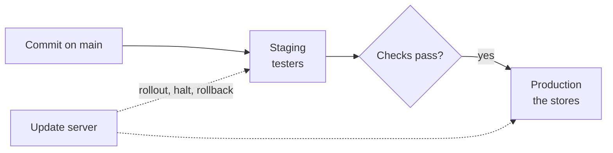

- **The screen updates over the air.** The bridge builds the screen after
  each commit, and the apps load it with no new install. Only a change to
  a native shell needs a new build of the app.
- **A phone app runs a screen only when it is new enough.** `needs()` in
  `version.ts` gives the N of the last change to a native shell. So an old
  phone app never gets a screen that calls a native function that it does
  not have.
- **The update server** (`updates/worker.ts`, a Cloudflare Worker) gives
  each copy its version, by channel and platform. It can give a new
  version to a part of the installs first, stop a release, or go back.
- **The Mac app installs only signed updates.** The updater runs only in a
  release build, and it installs only an update that the release key
  signs. A fork cannot send updates to the users of Yonder.
- **The checks** (`.github/workflows/check.yml`) run on each push. The
  official builds are signed and released by the maintainers.

## Security

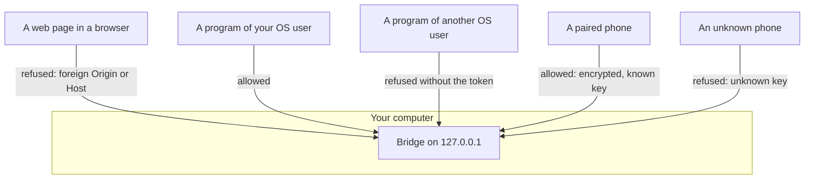

> [!WARNING]
> By default the agents run with `--dangerously-skip-permissions`. The
> Permissions row of the Settings changes it. Each program of your OS
> user can call the bridge, and each agent can call the tools of Yonder.

- The bridge listens only on `127.0.0.1`. It refuses requests from web
  pages other than the Yonder window, and requests with a foreign `Host`
  header.
- A request passes only from a program of the same OS user, or with the
  secret `token` of `config.json`. So two OS users on one computer each
  run their own bridge, on their own port, and cannot reach each other.
- The phone reaches the bridge only through the end-to-end encryption
  above, with a key that you paired.
- A plugin runs with all the rights of your user.
- `use_secret` gives an agent a login or a key from a 1Password service
  account, only after you approve it on the phone or in Yonder on the Mac. The computer keeps the
  token only sealed to your phones, and never keeps a value.

Report a security problem as [`SECURITY.md`](../SECURITY.md) tells. Do not
open a public issue for it.

## Cost

Yonder is free and open source. You pay only for the services that you choose:

- **The agents** use your own CLI plans, such as your Claude subscription.
- **A voice call** uses the provider and the key that you choose. See
  [Voice](voice/README.md).
- **The relay** is free. You can also run your own.

## A map of the repository

Most of the code is the screen and the bridge. The native shells are thin:
they host the one React app on each platform.

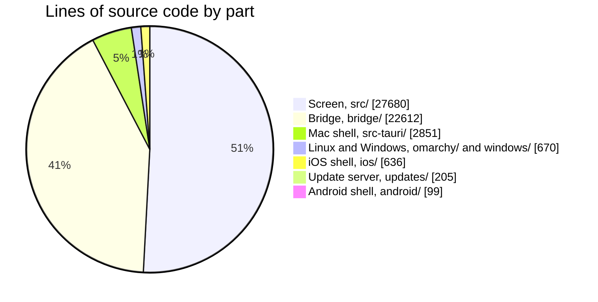

| Folder | What it holds |
|---|---|
| `src/` | The screen: one React app for the Mac, the phones, Linux and Windows. `App.tsx` is the main view, `voice.ts` the voice call, `link.ts` the encryption of the phone, `elsewhere.ts` the other environments. |
| `bridge/` | The bridge. `main.ts` is the MCP server and the agents, `clis.ts` the other CLIs, `acp-host.ts` the ACP host, `relay.ts` the relay link, `mod.ts` writes Yonder's mod. |
| `themes/` | The built-in themes, one folder each, and the list `index.ts`. |
| `plugins/` | Yonder's own mod, a Claude Code plugin. |
| `relay/` | The relay (`main.ts`), its Docker files, its README and its check. |
| `src-tauri/` | The Mac app (Tauri), with the notch, the keys and the menu bar. |
| `ios/`, `android/` | The phone apps (Tauri mobile), with the widgets, the share sheet, CarPlay and the watch. |
| `omarchy/`, `windows/` | The installers and the `yonder` command for Linux and Windows. |
| `updates/` | The update server at `updates.yonder.so`. |
| `docs/` | The wiki and one doc for each large part. |
| `version.ts`, `health.ts`, `promote.ts`, `channel.json` | The version, the health check, the promotion to production and the channel of a build. |

## Planned

These parts are designed, but not built yet:

- Your own themes and plugins in `~/.config/yonder/themes/` and
  `~/.config/yonder/plugins/`, so a `git pull` never touches them.
- A list of plugins in the Settings, with an install from any GitHub
  repository.

## License

The code is under the [MIT license](../LICENSE). The name Yonder, the bird and
the icons are not; see [`TRADEMARK.md`](../TRADEMARK.md). The forks in
`ios/tao/` and `ios/swift-rs/` keep their own licenses.

[`CONTRIBUTING.md`](../CONTRIBUTING.md) tells how to set up, run the checks
and send a pull request.
