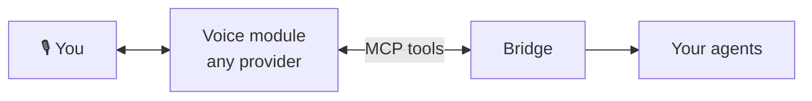

# Voice

Voice is an optional module of Yonder. Without it, you chat with your
agents. With it, you also talk to them in a call: a voice agent hears the
task, starts an agent, and tells you the result.

The voice module is pluggable. You choose where the speech runs and which
model talks: a model in the cloud with your own key, models on your own
computer, or a voice system that you build yourself.

## How a voice module connects

Each voice module does the same three jobs: it hears you, it calls the
tools of the bridge, and it talks back. The bridge does not change.

- The voice module gets the tools of the bridge, such as `start_worker`
  and `list_workers`, as its function tools.
- The state of the agents goes into the prompt of the voice agent, so it
  can answer a question at once.
- The audio does not go through your computer when the provider is in the
  cloud. Only the tool calls do.

## Choose a voice module

| Option | Where it runs | Status | Guide |
|---|---|---|---|
| Grok realtime (xAI) | xAI cloud, with your own key | Built | [Grok](grok.md) |
| OpenAI, ElevenLabs, Claude | Their cloud, with your own key | Built | [Other cloud models](cloud.md) |
| Speech on your own computer | Your Mac, Linux PC or phone | Dictation built, local calls planned | [Local speech](local.md) |
| Pipecat | Your own computer or server | Planned | [Pipecat](pipecat.md) |
| Your own voice system | Anywhere | Built: any MCP client | [Your own system](custom.md) |

## Speech to text without a call

You do not need a call to use your voice. Dictation turns your words into
the text of a message, and you send it as a chat:

- On the phone, the speech recognizer of iOS or Android.
- On a Mac, the speech model of Apple.
- On a Mac, the notch: tap the right ⌘ key, say the task, and tap again
  to send.
- On Linux, Voxtype. On Windows, Windows + H.

[Local speech](local.md) tells more.
