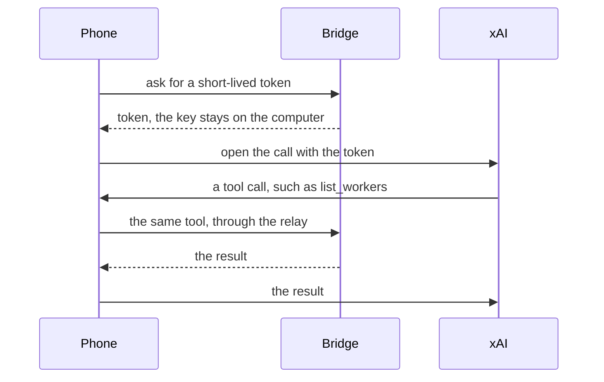

# Voice with Grok

Grok realtime from xAI is the voice agent that Yonder uses by default. You
use your own xAI key, and xAI bills you for your calls.

## Set it up

1. Get an API key at <https://console.x.ai>.
2. On the computer that runs Yonder, put the key in
   `~/.config/yonder/.env`:

   ```sh
   XAI_API_KEY=xai-...
   ```

3. Start a call from the phone app.

## How it works



- The bridge gives the phone an ephemeral token, so your API key never
  leaves your computer.
- The audio goes from the phone straight to xAI. Only the tool calls go
  through your computer.
- Echo cancellation keeps the voice of Grok out of the microphone, so you
  can talk over it.

## Cost

xAI bills the whole time that a call is open, not only the speech. The
prices are at <https://docs.x.ai>.

## Choose a voice

Grok has many voices, such as Ara, Eve, Leo and Liora (`GROK_VOICES` in
`src/voice.ts`). The default voice is Liora.
